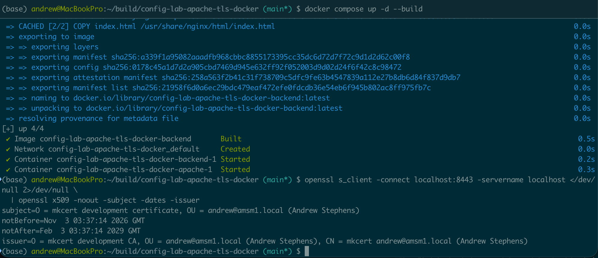
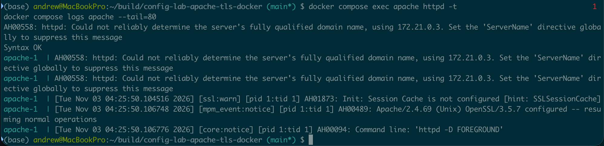
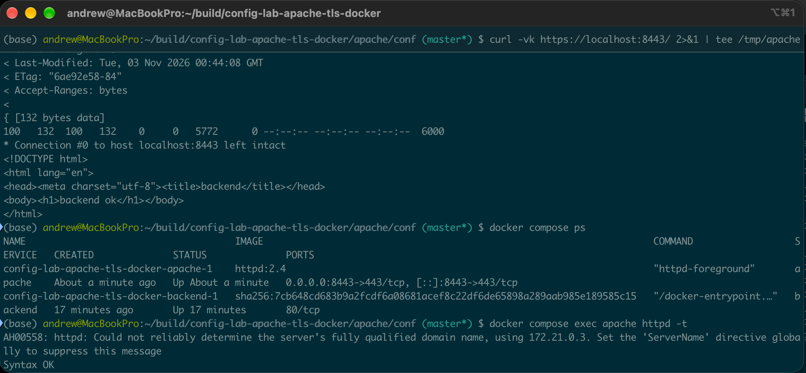

# Apache TLS termination and reverse proxy lab

This project demonstrates configuring Apache HTTP Server 2.4 in Docker as a TLS termination point and reverse proxy for an NGINX backend container. It covers local TLS certificate generation, Apache virtual host configuration, Docker Compose networking, and HTTPS connectivity validation using `curl` and `openssl`. The lab also includes troubleshooting exercises involving backend availability, certificate configuration, DNS resolution, and port conflicts, with documented root cause analysis and recovery procedures.

**Quick Screenshots of the final result**

Bring the docker services up from the docker-compose.yml as a basis of instruction and testing the SSL certificate data.


Provides confirmation that the Apache services are up and running as intended.


Gives us the greenlight that the container services are working as intended.


## Architecture

```text
                  HTTPS Request
                Browser / curl
                      |
                      v
              localhost:8443
                      |
                      v
          +-----------------------+
          | Apache HTTP Server    |
          | Docker container      |
          | Port 443              |
          | TLS termination       |
          | Reverse proxy         |
          +-----------------------+
                      |
                      | HTTP
                      | ProxyPass http://backend:80/
                      v
          +-----------------------+
          | NGINX Backend         |
          | Docker container      |
          | Port 80               |
          | Serves index.html     |
          +-----------------------+
                      |
                      v
                 "backend ok"
```

Both containers communicate over the Docker Compose network, where the `backend` service name resolves through Docker's internal DNS.

## Quick start

**Prerequisites:** Docker Engine or Docker Desktop, Docker Compose, OpenSSL, and an available host port `8443`.

Clone the repository and enter the project directory.

Generate local TLS certificates:

```bash
chmod +x scripts/gen-certs.sh
./scripts/gen-certs.sh
```

Start the Apache and NGINX containers:

```bash
docker compose up -d --build
docker compose ps
```

Verify HTTPS connectivity and the reverse proxy response:

```bash
curl -vk https://localhost:8443/
```

Expected response includes:

```html
<h1>backend ok</h1>
```

Inspect the TLS certificate:

```bash
openssl s_client -connect localhost:8443 -servername localhost </dev/null 2>/dev/null \
  | openssl x509 -noout -subject -dates -issuer
```

Validate Apache configuration and inspect logs:

```bash
docker compose exec apache httpd -t
docker compose logs apache --tail=80
```

Shut down the lab:

```bash
docker compose down
```

## Troubleshooting and root cause analysis

See [Connectivity troubleshooting runbook](docs/runbook-connectivity.md) for fault-injection exercises, diagnostic commands, root cause findings, and recovery procedures.

## Lab disclaimer

This is a self-directed homelab project intended to demonstrate Apache HTTP Server configuration, TLS fundamentals, Docker networking, and reverse proxy troubleshooting. It does not represent production Apache administration experience or hands-on experience with F5 BIG-IP infrastructure. Certificates and configurations are for local testing only and are not production-hardened. Private keys must not be committed to Git.

## License

This project is licensed under the MIT License. See [LICENSE](LICENSE) for the full license text.
